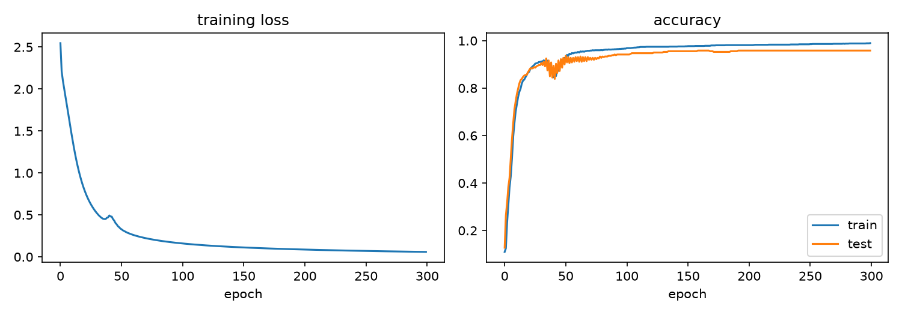
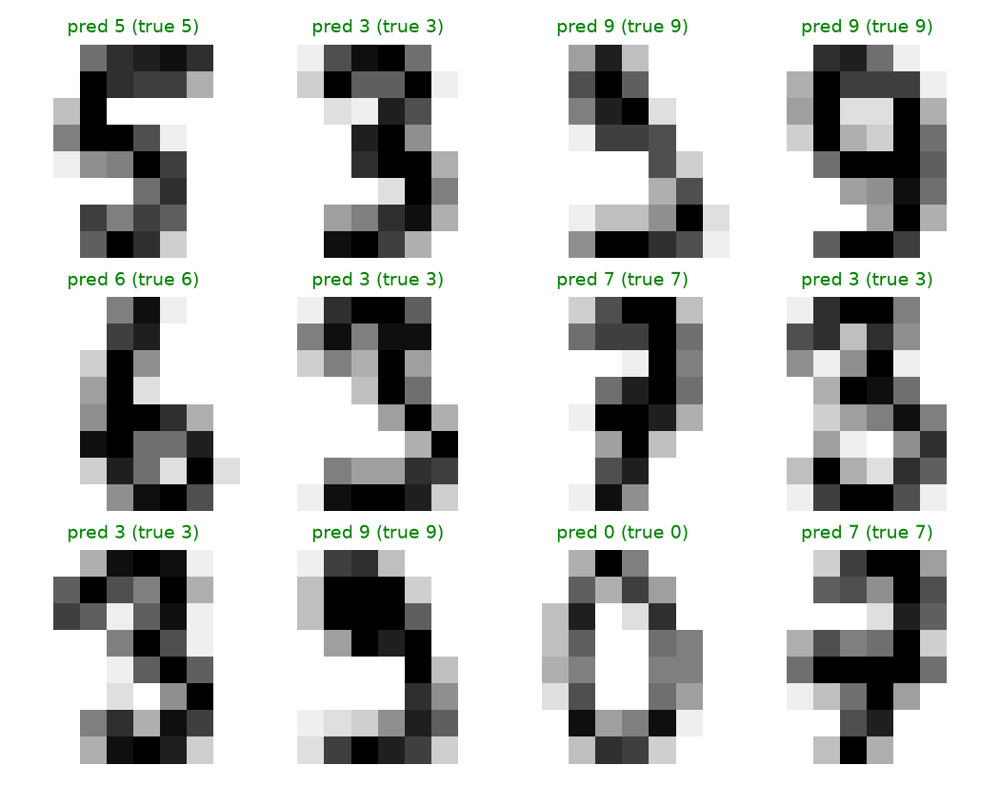
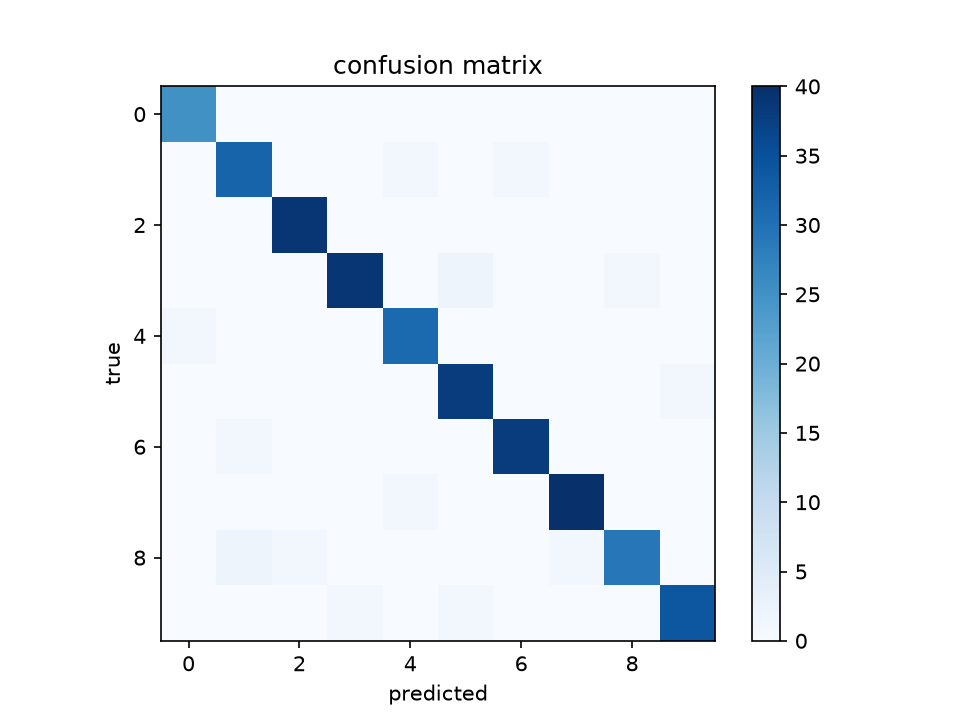
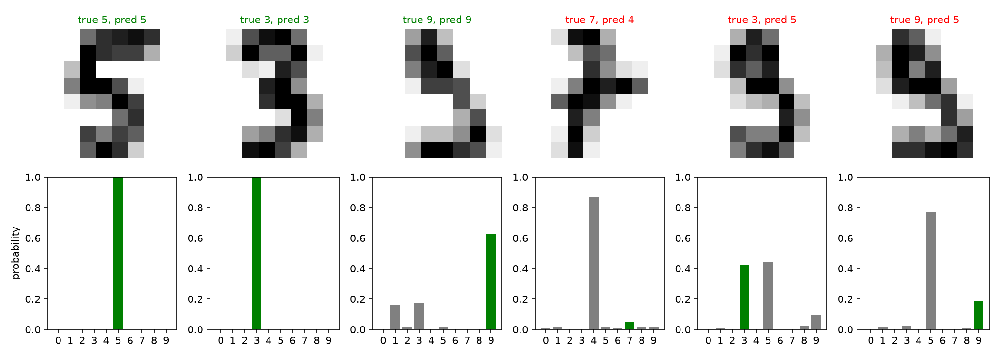
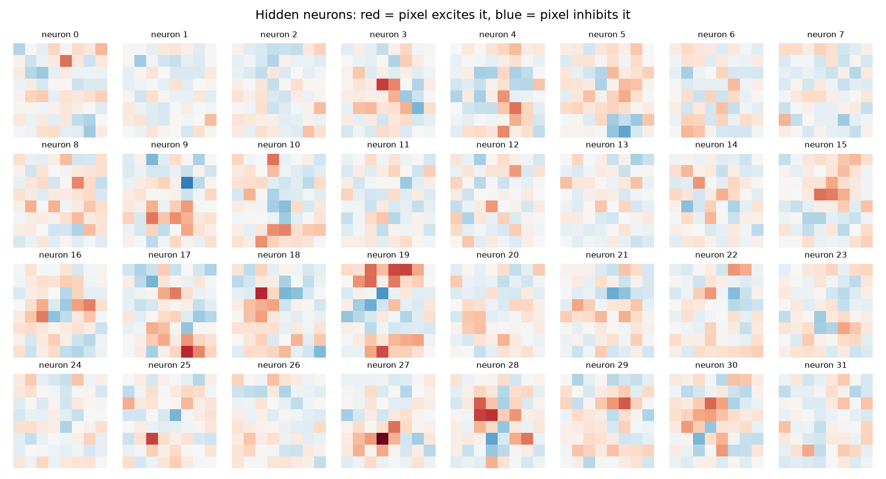

# Neural Network from Scratch in NumPy

A neural network that reads handwritten digits (0 to 9), written from scratch in NumPy, including backpropagation. No PyTorch, no TensorFlow.

## Results

- **Test accuracy: 95.8%** (345 of 360 unseen images correct)
- Dataset: scikit-learn digits (1,797 images, 8x8 pixels), split 80% train / 20% test with a fixed seed
- Gradient check: backprop matches a numerical gradient to about 1e-11





## Architecture

64 inputs (pixels) → 32 hidden neurons (ReLU) → 10 outputs (softmax). 2,410 parameters in total. Trained with full-batch gradient descent (learning rate 0.5, 300 epochs), cross-entropy loss, He initialization.

## Backprop in three lines

```python
d2 = (p - Y) / N                   # softmax + cross-entropy gives this simple output error
d1 = (d2 @ W2.T) * (z1 > 0)        # push the error back through W2 and through ReLU
dW1 = X.T @ d1                     # (dW2 = h.T @ d2 works the same way)
```

## Experiments

Full tables and explanations are in [experiments.md](experiments.md). Summary:

| Experiment | Finding |
|---|---|
| Learning rate | 0.01 too slow (64%), 0.5 best (95.6%), 2.0 breaks the network (7%) |
| Hidden size | 4 → 80%, 8 → 89%, 32 → 95.6%, 128 → 95.8% (diminishing returns) |
| Epochs | Test accuracy rose from 87.8% (20 epochs) to 97.2% (1000 epochs) with a steady 3-point train/test gap |
| ReLU on/off | Without ReLU, still about 95%, because 8x8 digits are almost linearly separable |

Note: the experiments use a different random initialization from the main run, so the same settings can differ by an image or two.

## What I learned

- Backpropagation is the chain rule applied layer by layer, and a numerical gradient check is a reliable way to test it.
- The learning rate matters a lot: too small is slow, too large overshoots and destroys training.
- More capacity helps until the network has enough, then returns diminish.
- A nonlinearity such as ReLU is required for the network to be more than one layer in principle, though this easy dataset hides the effect.

## Run it

```
python -m venv venv
venv\Scripts\activate        # Mac/Linux: source venv/bin/activate
pip install -r requirements.txt
python train.py              # trains, prints results, saves the three charts
python experiments.py        # runs the experiments
```

## Files

- `train.py`: the full project in one file
- `experiments.py`: the learning rate, hidden size, epochs, and ReLU experiments
- `experiments.md`: experiment tables and explanations
- `steps/`: the step-by-step build scripts


## Looking inside the network



The network's confidence for six test digits (the green bar marks the true digit). It is nearly certain on easy digits. Its mistakes are instructive: a true 3 predicted as 5 split the probability almost evenly (roughly 44% vs 42%), while a true 7 was predicted as 4 with roughly 87% confidence, so the network can be confidently wrong.



Each square shows the 64 input weights of one hidden neuron as an 8x8 image (red excites, blue inhibits). In this small network the weights do not form clean stroke detectors: most neurons look diffuse, and a few (for example neurons 19, 27 and 28) show more localized patterns. The knowledge appears to be distributed across neurons.